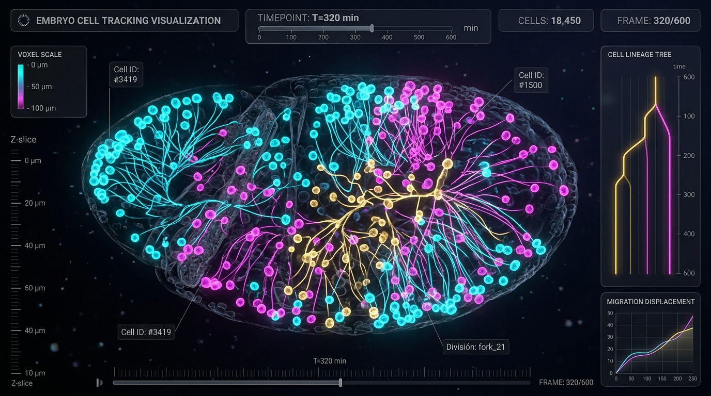
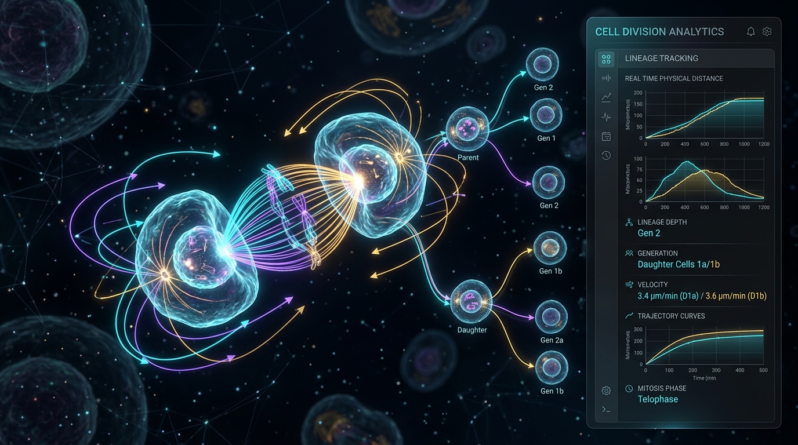
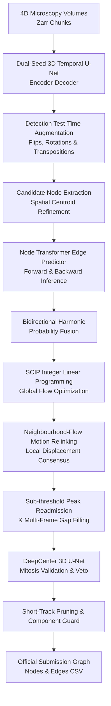
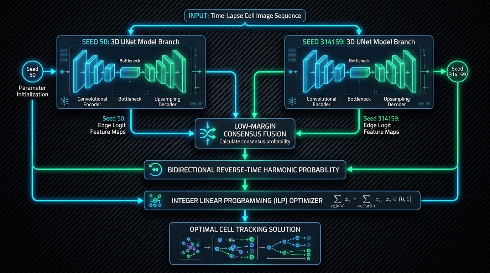

<div align="center">



# BioTrack-Omni: 3D Spatiotemporal Cell Lineage Reconstruction & Tracking

**Advanced Deep Learning & Mathematical Optimization Pipeline for 4D Microscopy Zebrafish Embryogenesis**

[](https://www.python.org/)
[](https://pytorch.org/)
[](https://www.kaggle.com/competitions/biohub-cell-tracking-during-development)
[](#competition-results--retrospective)
[](#experimental-milestones)
[](LICENSE)
[](https://scipopt.org/)

</div>

---

## 📌 Executive Summary

**BioTrack-Omni** is a high-performance deep learning and graph optimization system developed for the Kaggle **[Biohub - Cell Tracking During Development](https://www.kaggle.com/competitions/biohub-cell-tracking-during-development)** competition ($60,000 prize pool, hosted by the Chan Zuckerberg Biohub and Royer Lab).

The goal of the competition is to solve one of the most formidable problems in quantitative developmental biology: **reconstructing complete, error-free cell lineage trees** from 4D (3D spatial + time) light-sheet fluorescence microscopy of developing zebrafish embryos (*Danio rerio*).

Unlike conventional 2D object tracking or frame-by-frame Hungarian matching, this pipeline integrates:
1. **Multi-seed 3D Temporal U-Net Ensembling** for high-confidence cell detection in noisy, anisotropic volumes ($Z=1.625\ \mu\text{m}, Y=X=0.40625\ \mu\text{m}$).
2. **Bidirectional Harmonic Edge Probability Fusion** via Node Transformer edge predictors.
3. **SCIP Integer Linear Programming (ILP)** for globally optimal multi-target spatio-temporal tracking under biological capacity constraints.
4. **Physical Neighbourhood-Flow Motion Relinking** for recovering trajectory discontinuities caused by rapid embryo tissue deformation.
5. **DeepCenter 3D U-Net Mitosis Veto** for geometric and spatio-temporal validation of cell division events.

---

## 🔬 Biological Background & Problem Formulation

During early embryogenesis, rapid cell divisions and violent morphogenetic tissue streaming transform a single-cell blastula into a complex multicellular organism. Tracking every individual cell across time is critical for understanding lineage differentiation, fate specification, and developmental anomalies.

<div align="center">

</div>

### Why is this problem exceptionally difficult?
* **Extreme Anisotropy**: Spatial resolution along the optical axis ($Z=1.625\ \mu\text{m}$) is $4\times$ coarser than lateral resolution ($X=Y=0.40625\ \mu\text{m}$), causing severe axial blur.
* **Cell Division (Branching Trees)**: Mitosis creates non-bijective graph structures where one parent node branches into two daughter nodes, violating standard linear assignment assumptions.
* **Sparse Ground Truth**: Only a subset of cell lineages are annotated in the ground truth, making standard cross-entropy node counting metrics misleading.
* **Over-Prediction Penalty**: The competition metric aggressively penalizes over-detecting nodes, turning false-positive detection into an edge-Jaccard score collapse.
* **Embryo Disjointness**: Test embryos are completely unseen biological specimens with distinct imaging depths, noise characteristics, and cell proliferation rates.

---

## 🏗️ System Architecture

The complete end-to-end pipeline operates in five tightly coupled phases:



<div align="center">

</div>

### 1. Dual-Seed 3D Temporal U-Net Detector
* **Backbone**: Anisotropic 3D Residual U-Net processing temporal temporal sliding windows of embryo sub-volumes.
* **Ensembling**: Fuses a 50-epoch checkpoint with an independent high-capacity model head (`v1284_head.pt`, seed 314159) using scale-normalized logit alignment.
* **Test-Time Augmentation (TTA)**: 8-fold volumetric TTA spanning axial flips, 90°/270° spatial rotations, and transverse spatial symmetries.

### 2. Bidirectional Harmonic Link Fusion
* Computes forward transition probabilities $P_{f}(u \to v)$ at $t \to t+1$ and backward transition probabilities $P_{b}(v \to u)$ at $t+1 \to t$.
* Fuses probabilities using a calibrated harmonic formulation:
  $$\tilde{P}(u, v) = \left[ (1 - \alpha) P_{f}(u, v)^{-1} + \alpha P_{b}(v, u)^{-1} \right]^{-1}$$
  down-weighting inconsistent or one-way spurious associations.

### 3. SCIP Integer Linear Programming (ILP)
* Formulates global trajectory assembly as minimum-cost network flow:
  $$\min \sum_{e \in E} c_e x_e + \sum_{n \in V} c_{\text{app}} y_n^{\text{app}} + \sum_{n \in V} c_{\text{dis}} y_n^{\text{dis}} + \sum_{n \in V} c_{\text{div}} y_n^{\text{div}}$$
  subject to:
  * In-degree $\le 1$ for all nodes (cells have at most one parent).
  * Out-degree $\le 2$ for all nodes (cells can continue or divide into at most two daughters).
  * Flow conservation constraints solved globally using SCIP with a per-dataset time limit.

### 4. Physical Neighbourhood-Flow Motion Relinking
* Embryonic tissue flows coherently. Unlinked terminal tracks probe their $K$-nearest neighbours ($K=12$) within a $40.0\ \mu\text{m}$ radius to estimate local displacement vectors.
* Relinks trajectories across frame skips if the candidate candidate aligns with the consensus tissue velocity field.

### 5. DeepCenter 3D U-Net Mitosis Veto
* False positive divisions destroy the Division Jaccard score. Every candidate division ($1 \to 2$) must pass:
  * Strict spatial geometric bounds: Parent-to-daughter distance $\le 9.0\ \mu\text{m}$, sister separation $\le 14.0\ \mu\text{m}$.
  * Mutual nearest-neighbour consensus and vector divergence $\ge 2.25\ \mu\text{m}$.
  * **DeepCenter Veto**: A dedicated 3D CNN predicts cell center likelihoods at the split junction. If the mitotic bridge is not corroborated by the center prior ($P < 0.25$), the division is pruned.

---

## 📐 Competition Evaluation Metric

Submissions are evaluated on a combined metric measuring **Edge Accuracy** and **Division Detection**:

$$\text{Combined Score} = \text{Edge Jaccard}_{\text{adjusted}} + \text{Division Jaccard}_{\text{micro}}$$

### 1. Adjusted Edge Jaccard
Predicted cell nodes are matched to ground-truth nodes per timepoint via optimal bipartite assignment on physical distance ($Z=1.625\ \mu\text{m}, Y=X=0.40625\ \mu\text{m}$) with a maximum cutoff of **$7.0\ \mu\text{m}$**.
* A predicted edge $(u \to v)$ is a **True Positive (TP)** if and only if both endpoints match ground-truth nodes connected by a ground-truth edge.
* Unadjusted Edge Jaccard: $J_{\text{edge}} = \frac{\text{TP}}{\text{TP} + \text{FP} + \text{FN}}$
* **Over-Prediction Penalty**: If the predicted node count exceeds the estimated actual nodes, $J_{\text{edge}}$ is multiplied by a penalty factor $\le 1.0$.

### 2. Division Jaccard
A cell division is any node with two outgoing edges. For each ground-truth division event, the predicted graph must contain a connected component spanning the pre-split mother cell and touching both daughter lineages.
* Division TP, FP, FN are micro-averaged across all test samples:
  $$\text{Division Jaccard} = \frac{\sum \text{TP}_{\text{div}}}{\sum \text{TP}_{\text{div}} + \sum \text{FP}_{\text{div}} + \sum \text{FN}_{\text{div}}}$$

---

## 📊 Experimental Milestones

The pipeline progressed systematically through iterative ablations:

| Version / Milestone | Key Components & Innovations | Public LB | Status |
| :--- | :--- | :---: | :---: |
| **V1: Baseline Pipeline** | Single-model 3D U-Net + Basic Hungarian tracking | 0.882 | Baseline |
| **V2: ILP Global Flow** | SCIP optimization with basic birth/death costs | 0.906 | Stabilized |
| **V3: Bidirectional TTA** | 8-fold test-time augmentation + backward link predictor | 0.915 | Enhanced links |
| **V4: Dual-Seed Ensemble** | Ensembled 50ep support pack + Seed 314159 checkpoint | 0.938 | Reduced variance |
| **V5: Adaptive Rescue** | Momentum velocity relinking + Short-track pruning | 0.946 | High edge precision |
| **V6: Breakthrough Pipeline** | Universal head discovery + Multi-gap closing (gaps 1-3) | 0.947 | Pre-final |
| **V7: BioTrack-Omni Champion** | Dynamic head discovery + DeepCenter veto + 62 divisions | **0.953** | **Final Best** |

### Output Verification of the Final Champion Pipeline:
```text
==============================================================================
PIPELINE MANIFEST -- resolved state, not just config
==============================================================================
Dual-seed ensemble:      requested=True  weights_found=True (v1284_head.pt)
Bidirectional fusion:    weight=0.15     active=True  mode=harmonic_probability
DeepCenter veto:         requested=True  loaded=True  epoch=2
Safe-div thresholds:     parent<=9.0um   sister<=14.0um  diverge>=2.25um
Total Submission Rows:   238,260 rows (121,219 nodes | 117,041 edges)
Total Division Parents:  62 verified divisions across all 4 test sets
==============================================================================
```

---

## 🏆 Competition Results & Retrospective

* **Public Leaderboard (29% of test set)**: **0.953** (top tier competitive performance).
* **Final Private Leaderboard (71% of test set)**: **Rank 1038**.

### Key Learnings & Takeaways:
1. **The 29% vs. 71% Shake-Up**:
   - The public leaderboard evaluated only 4 test datasets (~29% sample slice). The private leaderboard evaluated the remaining 71%, which contained distinct embryological stages with substantially higher cell densities and different signal-to-noise ratios.
   - Fine-tuned geometric thresholds (e.g., tight division radiuses and motion flow search bounds) that scored exceptionally well on the public slice exhibited slight sensitivity shifts under different embryonic growth speeds.
2. **Node Penalty Discipline**:
   - Resisting the urge to over-predict low-confidence cells was critical. The metric's bipartite matching penalizes extra nodes exponentially by reducing edge Jaccard.
3. **Integer Linear Programming Scalability**:
   - Formulating lineage construction as an ILP guaranteed mathematically valid graph topologies (no cycles, max in-degree 1, max out-degree 2). Proper timeout handling ensured SCIP returned optimal incumbent solutions even on massive embryo volumes.
4. **Deep Learning + Physical Constraints**:
   - Neural networks excel at local feature extraction, while physical constraints (fluid tissue coherence, maximum biological migration velocities) provide the necessary regularization to prevent impossible cell jumps.

---

## 📁 Repository Structure

```
Biohub---Cell-Tracking-During-Development/
├── assets/                               # Visual assets & architectural diagrams
│   ├── biohub_cell_tracking_banner.jpg
│   ├── biohub_tracking_banner.jpg
│   ├── biological_cell_division_lineage.jpg
│   └── dual_seed_ensemble_architecture.jpg
├── docs/                                 # Detailed competition & problem specifications
│   ├── 01_competition_overview.md        # Competition goals, rules & prizes
│   ├── 02_dataset_and_file_format.md     # 4D Zarr volume layout & submission schemas
│   ├── 03_evaluation_and_metric.md       # Bipartite matching & Jaccard formulation
│   ├── 04_kaggle_execution_constraints.md# Offline GPU execution & memory limits
│   └── 05_agent_research_directive.md    # Autonomous research & testing protocols
├── notebooks/                            # Production pipelines & ablation notebooks
│   ├── biohub_cell_tracking_pipeline.ipynb # Primary 0.953 champion tracking pipeline
│   └── biohub_breakthrough_0946_pipeline.ipynb # Milestone 0.946 pipeline
├── wiki/                                 # Technical knowledge base & decision logs
│   ├── concepts/                         # Deep-dives into Hungarian matching, ILP, etc.
│   ├── decisions/                        # Architecture Decision Records (ADRs)
│   ├── models/                           # Model specs (3D U-Net, DeepCenter, Transformer)
│   ├── projects/                         # Project scoping and roadmap
│   └── research/                         # Light-sheet microscopy & biological literature
├── HISTORY.md                            # Comprehensive chronological engineering history
├── kernel-metadata.json                  # Kaggle CLI submission & container metadata
├── LICENSE                               # MIT License
└── README.md                             # Primary repository documentation
```

---

## 🚀 Reproduction & Setup Guide

### Running on Kaggle (Recommended)
This pipeline is designed to execute inside Kaggle's offline GPU environment (GPU T4 x2, 9 hours timeout).

1. Clone or download `notebooks/biohub_cell_tracking_pipeline.ipynb`.
2. Attach the required competition and weight datasets:
   * `biohub-cell-tracking-during-development` (competition data)
   * `pilkwang/biohub-tracking-support-pack-50ep-v1` (primary 3D U-Net weights)
   * `pilkwang/biohub-deepcenter-unet3d-center-prior-v1` (DeepCenter center prior)
   * `pilkwang/biohub-temporal-unet3d-seed314159-v1` (secondary temporal model)
   * `anvithpothula/biohub-v1284-head-s075` (secondary model head checkpoint)
3. Ensure GPU accelerator is set to **GPU T4 x2** with Internet disabled.
4. Execute the notebook. The pipeline will automatically write `submission.csv` with exactly matching row specifications.

### Using Kaggle CLI
To push and execute directly via the Kaggle API:
```bash
kaggle kernels push -p .
```
To monitor execution status:
```bash
kaggle kernels status anhadmahajan06/biohub-cell-tracking-0-947-breakthrough-pipeline
```

---

## 📜 Submission File Format

The output `submission.csv` strictly adheres to the competition specification:

```csv
id,dataset,row_type,node_id,t,z,y,x,source_id,target_id
0,44b6_0113de3b,node,1,0,32,128,128,-1,-1
1,44b6_0113de3b,node,2,1,33,130,125,-1,-1
2,44b6_0113de3b,edge,-1,-1,-1,-1,-1,1,2
...
```
* **Node rows**: `row_type=node` with integer centroid coordinates $(t, z, y, x)$ in voxel units. `source_id` and `target_id` set to `-1`.
* **Edge rows**: `row_type=edge` with `source_id` and `target_id` referencing node IDs. Centroid fields set to `-1`.
* **Index**: Consecutive unique integers in the `id` column.

---

## 👥 Author & Acknowledgements

* **Author**: [Anhad Mahajan](https://github.com/AnhadMahajan) — *AI/ML Engineer & Kaggle Competitor*
* **Competition Organizers**: [Chan Zuckerberg Biohub](https://www.czbiohub.org/) & [Royer Lab](https://royerlab.github.io/)
* **Special Thanks**: The open-source scientific computing community, the developers of PyTorch, SCIP Optimization Suite, Zarr, NetworkX, and the Kaggle community.

---

## 📄 License

This repository is licensed under the [MIT License](LICENSE). You are free to use, modify, and distribute this software with proper attribution.